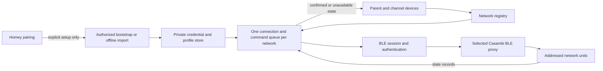

# Architecture

## Boundaries

`lib/casambi` implements wire records, unit-scoped commands, authentication,
network scheduling and explicit setup. `lib/ble` adapts the SDK-compatible BLE
interface, but imports no Homey module. `lib/devices/profile.js` parses fixture
bitfields; it contains no manufacturer, address or Flos channel constants.
`lib/homey` handles private persistence and device definitions. Drivers and app
code own SDK capabilities, Flow, pairing and lifecycle.

A **unit ID** addresses a light within a network. A **BLE proxy address** identifies
an advertised connectable node. They are separate identities: on the reference
hardware, the configuration's unit address did not match the usable BLE address.
Bootstrap retains the selected advertisement as a verified proxy; an offline
export can supply additional authorized proxies. The runtime does not infer proxy
addresses from unit records or contact a cloud service to find them.

## Profiles and state

Fixture fields describe state length, bit offsets and widths. P0 accepts up to
eight writable dimmers and at most one CCT and one power control. Auxiliary slider
bits remain untouched. RGB/sensor/unknown profiles, overlapping fields and unknown
CCT ranges are rejected. State lengths are bounded by the observed record format.

Homey parent and channel IDs include the opaque network ID, unit ID and channel
index. Channel devices share the network's confirmed raw state and its write queue.
A state change in one representation updates all others. CCT is shared because the
fixture exposes one temperature field. Keeping a parent supports common controls
without pretending that independent channels are separate BLE nodes.

The unit's last nonzero *vector* preserves channel ratios, including intentional
zeros, when the whole light is switched off/on. Per-channel nonzero memory restores
an individually switched-off channel. Those are distinct pieces of state.

## Connection and commands

An app registry reference-counts network managers. One session authenticates to a
verified proxy. All unit writes are serialized. The state listener is installed
before sending a command; success requires an exact matching state notification.
A network-generation check rejects commands queued before a reconnect. Failures
invalidate availability and refresh actual state without replaying uncertain writes.

An idle notification wait is bounded and cancellable. Connection establishment,
GATT discovery, writes and shutdown have phase deadlines. Late connections are
closed. Backoff is bounded at 60 seconds and proxy selection rotates. On restart,
credentials/profiles load from the private store and a fresh snapshot is required.

State quality is `confirmed`, `stale`, or `unavailable`. No UI prediction is stored
as confirmed state. After five minutes a bounded reconnect obtains a fresh snapshot,
since a generic state-poll opcode is not verified. This policy can cause availability
transitions; it is deliberately explicit rather than silently retaining stale data.

## Setup and persistence

Setup is an explicit, asynchronous job with short status requests, avoiding a
10-second pairing RPC timeout during scans or downloads. Passwords exist only for
the setup request. HTTPS is restricted to the Casambi origin; redirects are refused.
Errors do not include response bodies or credentials. Only supported lighting
fixtures are offered, with a skipped-fixture notice.

Private JSON is stored under `/userdata/casambi` using directory mode 0700, file
mode 0600 and atomic replacement. This relies on Homey's app isolation and system
security; it is not protection against the hub administrator or compromised firmware.
Nothing secret is stored in capability data, Flow tokens or Git. Uninstalling the
app removes its app data; back up an export privately if future offline recovery is needed.

## Intentional extension points

New lighting profiles can reuse generic bitfields and tests. Future RGB/groups/scenes
would require explicit new commands, models and capability mappings; P0 does not
include dormant implementations of those features. Do not broaden supported classes
solely because a fixture exposes an unfamiliar control.
